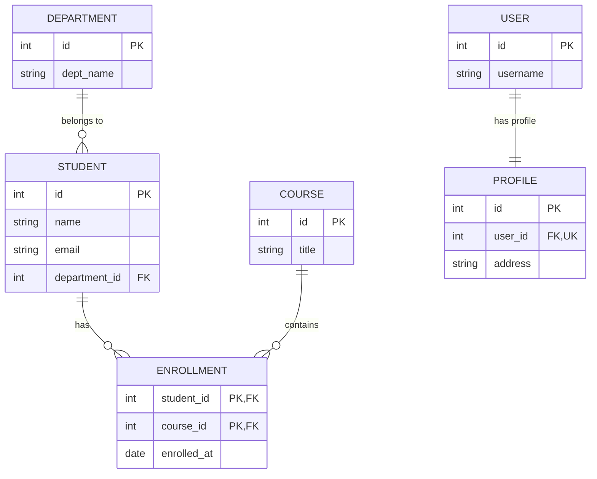

# Entity-Relationship (ER) Diagrams & Database Design Guide

## 1. What is an ER Diagram?
An Entity-Relationship (ER) Diagram is a visual representation of entities (tables), attributes (columns), and their relationships (keys) in a database.

---

## 2. Key Symbols & Notations
- **Entity (Rectangle)**: Database table (e.g. `Student`, `Department`).
- **Attribute (Oval)**: Properties/Columns of entity (e.g. `name`, `email`).
- **Key Attribute (Underlined Oval)**: Primary key (e.g. `<u>student_id</u>`).
- **Relationship (Diamond)**: Association between entities (e.g. `Enrolls In`, `Belongs To`).

---

## 3. Visual Relationship Diagram (Mermaid)

