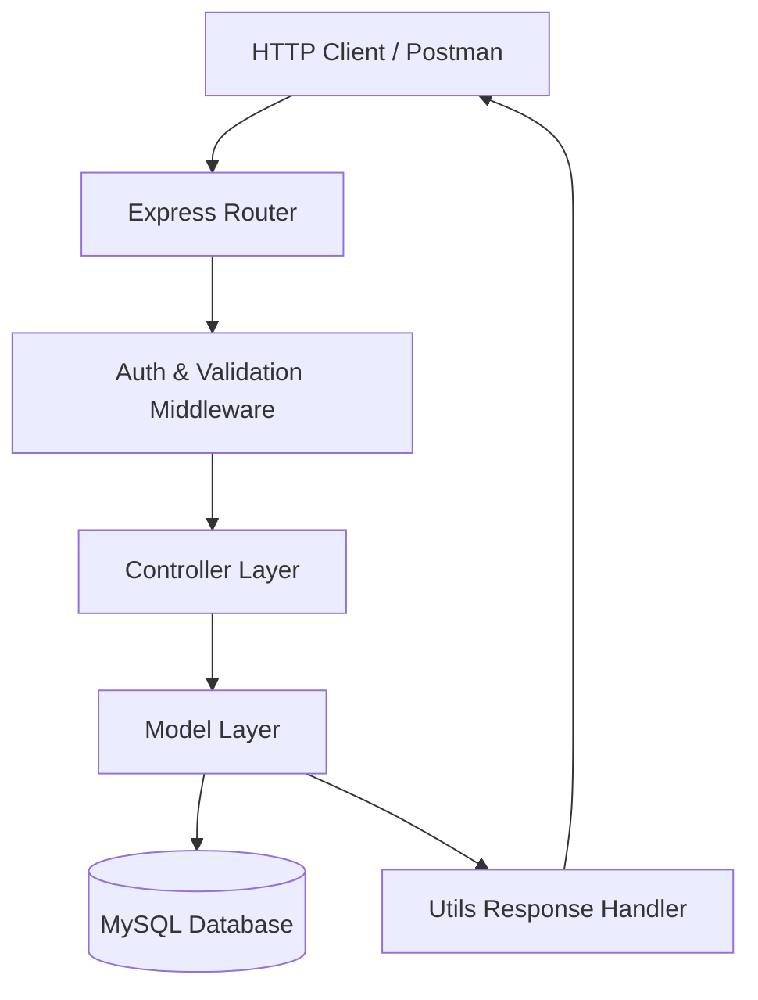

# Master Project Architecture Overview

## MVC Pattern & Layer Responsibility

### 1. Presentation Layer (`routes/` & `server.js`)
- Maps HTTP methods and URI endpoints to controller handlers.
- Applies route-specific validation and authentication middleware.

### 2. Middleware Layer (`middleware/` & `validation/`)
- `authMiddleware.js`: Verifies JWT tokens and enforces Role-Based Access Control (RBAC).
- `uploadMiddleware.js`: Handles file uploads using Multer with extension and size checks.
- `errorHandler.js`: Catches errors, formats output, and sets appropriate HTTP status codes.

### 3. Business & Controller Layer (`controllers/`)
- Handles request logic, validates input data flow, invokes models, and returns standardized responses using `utils/response.js`.

### 4. Data Access Layer (`models/` & `config/db.js`)
- Interacts with MySQL via `mysql2/promise` connection pool using parameterized SQL queries.
- Manages database transactions for atomic operations (such as order checkout).
